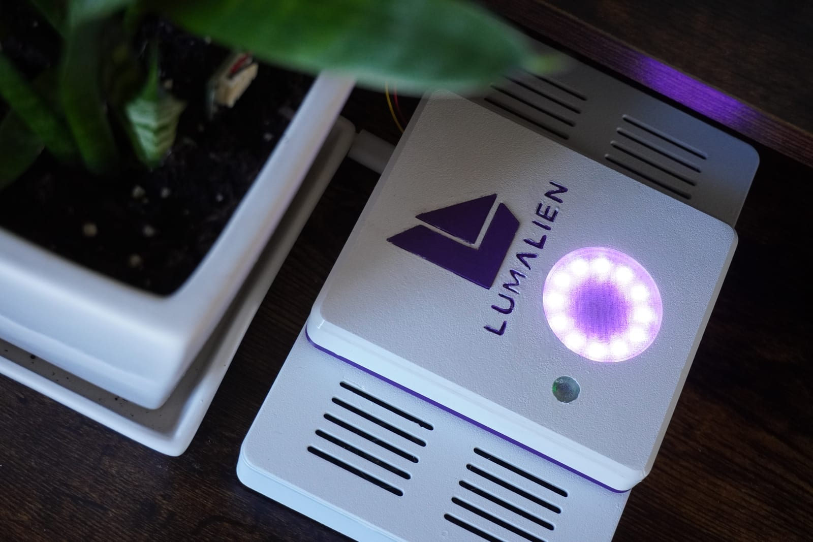

# Flora



FLORA is open source from end to end. This repository is the software. The STL files,
Blender model and bill of materials are in [flora-cad](https://github.com/patmakesapps/flora-cad).
Project page: [lumalien.com/flora](https://www.lumalien.com/flora).

A standalone Raspberry Pi 5 robotic plant companion using OpenAI Realtime
and live light, soil capacitance, temperature, and humidity measurements.
Everything runs from this repo; Humalien and LumaKit are not runtime dependencies.
Voice reasoning is online. Microphone audio reaches OpenAI while `run` is active.
The default model is `gpt-realtime-2.1-mini`, the lower-cost Realtime option.
The default voice is `shimmer`.

Plant identity, care history, and preferences are learned through conversation.
There is no built-in species or watering schedule. FLORA records sensor observations
and uses its tools and the plant's context to reason about helpful care advice.

## Bench hardware

- Waveshare WM8960 audio HAT: 48 kHz stereo PCM16 capture and playback.
- One 12-pixel GRB NeoPixel ring: 5 V on physical pin 4, ground on pin 6,
  DIN on **GPIO12 / physical pin 32**.
- Default brightness: **5/255 per active channel**, the dim purple test setting.
  Configuration cannot exceed 63/255 (about 25%).
- I2C bus 1 sensors: VEML7700 light at **0x10**, Adafruit STEMMA soil sensor
  (#4026, seesaw) at **0x36**, and SHT41 temperature/humidity at **0x44**.
  The WM8960 audio HAT uses **0x1A**; `UU` at that address means the kernel
  driver owns it and is expected.
- Light sensor sits behind a thin, partly transparent PETG window. Soil probe
  placement defaults to `false` until installation is saved in the plant profile.
- No camera needed.

## Setup

```bash
python3 -m venv .venv
.venv/bin/python -m pip install -r requirements.txt
cp .env.example .env
chmod 600 .env
```

Add your OpenAI API key to `OPENAI_API_KEY` in `.env`. Keep it out of chat and Git.
Model, voice, software speaker gain, and LED count/brightness are configurable.
The hub temporarily sets WM8960 `Capture` to 23/63 (0 dB) to reduce clipping,
and restores the previous mixer volume on clean shutdown. Adjust
`MIC_CAPTURE_VOLUME` in `.env` if needed. No ALSA state file is written.

```bash
.venv/bin/python -m flora check
.venv/bin/python -m flora sensor-test
.venv/bin/python -m flora led-test
.venv/bin/python -m flora audio-test
.venv/bin/python -m flora voice-test
.venv/bin/python -m flora run
```

`audio-test` measures 3 seconds of live mic input and plays a quiet test tone.
It saves no recording and makes no API calls. `led-test` shows four states,
then clears the ring. Press Ctrl+C to stop any command.
`voice-test` plays one Realtime greeting with the configured model and voice,
sends no microphone input, and then disconnects. It uses the API and is billed.
`sensor-test` prints a single live JSON snapshot from all three sensors, including
units, per-sensor status, UTC measurement timestamps, and placement limitations.
It requires no API key and does not start audio or LEDs. It exits with code 0
when all sensors read successfully, or 1 if any reading is unavailable; healthy
readings remain visible when another sensor fails. No production readings are simulated.

## Sensors and plant status

The installed Adafruit drivers are `adafruit-circuitpython-veml7700`,
`adafruit-circuitpython-seesaw`, and `adafruit-circuitpython-sht4x`, using Blinka
on the Pi. Existing installations can add them without recreating `.env`:

```bash
.venv/bin/python -m pip install -r requirements.txt
.venv/bin/python -m flora sensor-test
```

`requirements.lock.txt` captures the verified local dependency versions, including
the new drivers. Use it in place of `requirements.txt` for a pinned installation.
I2C must be enabled and the runtime user must have access to `/dev/i2c-1`
(normally through the `i2c` group). Your successful bus scan already confirms
the three devices are connected. Stop older FLORA processes before testing
or restarting with this version, so obsolete battery polling cannot continue.

The Realtime session exposes `get_plant_status` with no arguments. Questions
such as "How's my plant doing?" or "How much light am I getting?" trigger live
reads. The output contains:

| Section | Measurements | Interpretation |
| --- | --- | --- |
| `light` | `lux`, `raw_als` | At the sensor behind PETG; no window transmission correction |
| `soil` | `raw_capacitance` | Raw capacitive counts, never water-content percentage |
| `environment` | `temperature_c`, `temperature_f`, `relative_humidity_percent` | Air at the SHT41, potentially affected by enclosure/Pi heat |
| `plant`, `calibration`, `soil_comparison` | Saved plant details, calibration references, numeric comparison/uncertainty | Evidence the model interprets for care advice |
| `memories`, `preferences` | Recent saved facts and separately retrieved preferences | Context for the model's reasoning and communication |
| `observation_saved`, `observation_id`, `setup_id` | Persistence result and history identifiers | Measurements survive reconnects and restarts when storage succeeds |

Each live soil value is the median of five new readings spaced 100 ms apart.
The output retains `raw_samples`, `sample_spread`, and `sample_count`, so smoothing
does not hide the individual counts or pretend the sensor is noise-free. Temperature
and humidity remain separate fields from the SHT41 in `environment`.
Spoken temperatures default to Fahrenheit; explicit requests and saved unit
preferences take precedence. Soil descriptions use everyday words such as dry,
slightly moist, moist, or wet when supported by observations and context. The model
chooses those descriptions; there are no fixed raw-count cutoffs for them. A missing
dry reference limits interpretation without making the existing moist evidence
unusable. Raw counts and calibration details are available when requested.

Keep `SOIL_PROBE_IN_SOIL=false` while the probe sits outside a plant. After
installing it in soil, tell FLORA "The probe is now in my plant's soil." It saves
placement in the plant profile without a restart. Alternatively, set
`SOIL_PROBE_IN_SOIL=true` in `.env` and restart. Saved profile placement takes
precedence over the initial environment setting. Placement alone does **not**
calibrate moisture; the workflow below learns a benchmark for the actual pot.

The VEML7700 uses automatic gain/integration adjustment and checks for saturation;
light at the leaves and daily light exposure cannot be inferred from one snapshot.
The PETG window's transmission is unknown, so no multiplier is applied. Compare
readings with and without the window under steady lighting if practical before
calibrating it. SHT41 uses a heater-free, high-precision, CRC-checked measurement.
`persona.md` instructs FLORA to use successful live results, explain unavailable
readings, and avoid invented measurements, trends, or health diagnoses.

Missing drivers, I2C errors, invalid values, and device/CRC errors are reported
per sensor with `status: "unavailable"` and `null` measurements. A failed sensor
is reinitialized and retried once; a later request can recover without restarting
voice. No previous value is substituted for a failed reading. Each sensor hardware
snapshot or soil-sampling request has a five-second timeout. A timed-out I2C worker remains tracked until it finishes,
and further calls return `read_in_progress` instead of starting more workers.

The X1200 battery reader, polling task, configuration, and battery LED override
have been removed. Old `BATTERY_ENABLED` entries in `.env` are ignored. Address
`0x36` is used only by the STEMMA driver; no fuel-gauge register reads remain.

## Memory and plant setup

FLORA stores its own SQLite database at `data/flora.sqlite3`, inside this repo.
It uses Python's built-in `sqlite3`, WAL journaling, bounded lock waits, parameterized
queries, and separate connections per operation. Database work runs in threads
during conversations. `data/` is ignored by Git. It never imports LumaKit or opens
LumaKit's database; LumaKit's timestamped remember/recall/update/delete pattern
informed the local implementation.

Try saying:

- "My name is [your name]. Remember that."
- "My plant is a pothos called Pip. It lives on my desk."
- "What kind of plant do I have?"
- "Do you remember my name?"
- "Remember that I prefer being called [preferred name] instead."
- "Forget the fact about my name."

`remember` upserts a fact under a consistent subject, `recall` retrieves up to 20
matching/recent facts, and `forget` deletes the requested subject. `set_plant_profile`
saves the one current plant's name, species/type, location, potting mix, notes, and
probe placement. Unspecified fields are preserved. `get_plant_status` retrieves
the profile automatically, so FLORA can use the plant type you already told it.
Plant profile, facts, and calibration survive process restarts and voice reconnects.
This is shared memory for one robot, without voice identification or user accounts.
No conversation recordings/transcripts are stored. Inspect it without starting voice:

```bash
.venv/bin/python -m flora memory
```

## Observations, soil references, and learning over time

Ask for a reading at any time, including on a fresh installation with no plant
details. `get_plant_status` records light, raw soil counts, temperature, and humidity
in local SQLite history with timestamps, sensor failures, and the plant profile at
capture. `get_observation_history` retrieves these observations for the model to
reason about changes. It defaults to the latest 20 records from the current setup,
supports up to 100 per page, and returns `next_before_id` for older pages. Failed
storage is reported explicitly while fresh sensor readings remain available.

Soil capture is separate from establishing a reliable watering reference.
`calibrate_soil` retains its existing name for compatibility and now supports:

- `sample` (default): fifteen live readings in three median windows, with no
  physical-condition label. No species, placement, confirmation, or waiting period
  is required to collect evidence.
- `water_now`: a candidate reference for the plant's ready-for-watering condition.
- `watered`: a candidate reference for the watered, drained condition.

For a labeled capture, `confirmed=true` records that the user reported the physical
condition; `false` retains the label as tentative. Neither flag prevents sampling.
A requested "dry reading" does not itself establish that the soil is dry. FLORA can
take the measurement, explain what it shows, and learn more from the user. Air
readings can test hardware but do not represent dry soil.

Each capture stores the raw samples, median, full spread, window medians, timestamp,
label provenance, and caveats. Noisy, overlapping, or reversed references are retained.
Repeatability exceeding 5% of the median (or 10 counts), and a wet/dry difference
no greater than three times the larger raw spread (or 5 counts), produce quality
warnings instead of rejecting storage. Hardware failures record an unsuccessful
attempt, with `measurement_available=false`, and do not replace an active reference.
`saved=true` means the observation or attempt was stored; `reference_saved` separately
indicates whether the labeled measurement became the latest candidate of that kind.
Older candidates remain in history.

Numerical comparisons work with a single reference, including wet-only setups.
The output includes differences against each reference, timestamps, confirmation
status, and uncertainty that includes current sample noise. With two points,
`ready` means the references passed the numerical checks and have user-confirmed
labels; caveated pairs are `provisional`. These statuses never block measurements
or numerical comparison. Counts remain counts, never moisture percentages.
The model decides what those observations imply for the particular plant, light
exposure, air conditions, care history, and user. No species-specific care threshold
or scripted watering decision is encoded in the tools.

Profile text corrections preserve references. When the user reports a replacement
plant, repotting, or repositioning the soil probe, FLORA uses
`set_plant_profile(new_setup=true, ...)` to start a new measurement setup. It clears
active references while retaining past observations under their original setup.
The user can also request a calibration reset. History excludes earlier setups by
default; `include_previous_setups=true` retrieves them explicitly. Captures spanning
a profile/setup change are retained with a caveat and cannot become references for
the new setup. Existing installations automatically import saved calibration points
once, preserving their raw counts and original measurement dates.

For capture without voice, audio, or an API connection:

```bash
.venv/bin/python -m flora calibrate-soil sample
.venv/bin/python -m flora calibrate-soil water-now
.venv/bin/python -m flora calibrate-soil watered
.venv/bin/python -m flora calibrate-soil reset
```

The named `water-now` and `watered` CLI commands assert the corresponding physical
condition. `sample` makes no such assertion. Sensor-test snapshots also enter history.

Checks currently run **on request**. History provides the foundation for future
periodic checks and agent-selected notifications; no timer, proactive alerts, or
watering actuator is implemented. Sparse readings do not establish continuous
conditions or all-day light exposure.

## Raspberry Pi acceptance checks

These checks require the real Pi, sensors, enclosure, audio HAT, and ring:

1. Run `sensor-test` several times. Confirm all three statuses are `ok`, readings
   have timestamps, and the outside-soil probe is identified correctly. Cover
   and uncover the light window and check that lux changes; inspect temperature
   and humidity for plausible values, including after the Pi warms up.
2. Once a plant is installed, save its type and probe placement, and follow the
   calibration workflow above before trusting watering recommendations. Do not immerse
   the probe's electronics or treat the outside-soil reading as a dry-soil baseline.
3. Run `audio-test`, `led-test`, and `voice-test` to confirm microphone, speakers,
   and the four normal ring states still work. Then run FLORA and ask "How's my
   plant doing?", "What's the humidity?", and "Does my plant need water?" Verify
   the spoken values come from live measurements and soil/window limits are respected.
4. Power down, disconnect one sensor, and restart. Check that `sensor-test` shows
   the other readings and exits 1, and voice explains the missing measurement.
   Power down before reconnecting, then confirm reads recover. Also speak another
   question while FLORA is obtaining a reading and confirm audio stays responsive.

Driver/unit tests cannot establish actual bus stability, PETG transmission,
soil calibration, enclosure heat effects, or the model's live spoken behavior.
The real three-sensor CLI and the actual Realtime function-call/continuation flow
have been smoke-tested on this Pi without starting microphone/speaker playback.
Realtime remember/profile tools and recall after reconnect were also verified
using synthetic facts in a temporary database, removed after the test.

Driver references: [VEML7700](https://docs.circuitpython.org/projects/veml7700/en/latest/api.html),
[seesaw](https://docs.circuitpython.org/projects/seesaw/en/latest/api.html),
and [SHT4x](https://docs.circuitpython.org/projects/sht4x/en/latest/api.html).

## Voice behavior

The Pi connects directly to Realtime; no laptop or local hardware WebSocket.
Server speech detection ends your turn automatically. Flora currently has no
reminder or scheduling capability. Save personal communication preferences through
`remember` with `kind: "preference"`; `persona.md` defines the general role.

`get_current_time` reads the Pi's system clock on demand and returns the local
date/time, weekday, timezone abbreviation, UTC offset (in the ISO timestamp),
and the same instant in UTC. Try "What day is it?" or "What time is it?" It uses
the Pi's configured timezone, including daylight-saving changes; this Pi uses
`America/New_York`. Check `timedatectl status` if the clock or timezone is wrong.
FLORA checks the clock when saving dated, user-reported plant care, such as
"I watered my plant today." Watering recommendations still use live soil readings
and the pot's calibration. Checking the clock does not create scheduled reminders.

The microphone is suppressed during actual speaker playback plus a short echo
tail. This prevents self-conversation without an acoustic echo canceller, but
means you **cannot interrupt a spoken reply** in this first version. There is
no wake word yet: speak naturally while running; stop the process to stop capture.
Session failures reconnect with bounded backoff; a new session loses conversation
context. Audio and LEDs are released on shutdown. Credentials and conversation
transcripts are not logged. Known audio failures and Realtime error codes are
shown in retry warnings; raw server error messages are omitted. A microphone
read or speaker write stalled for five seconds triggers a fresh session. A network
send stalled for ten seconds, or a pending response with no progress for sixty
seconds while neither speaking nor hearing, also reconnects. Quiet idle time does
not trigger response recovery.

Service logs report speech detection and response start/end, plus audio health
counters every twenty seconds: raw microphone peak, captured/sent audio duration,
mic suppression during playback, received reply level/duration, bytes delivered
to ALSA, and remaining playback queue. These counters help distinguish capture,
network/response, and playback problems without saving audio or transcripts.
Delivery to ALSA does not prove that the physical speaker produced sound.

LED states:

| State | Ring |
| --- | --- |
| Idle (bench preview) | Solid dim purple |
| Listening | Slow purple pulse |
| Thinking | Purple circle sweep |
| Speaking (actual playback) | Green |
| Connecting | Amber circle sweep |
| Connection error | Dim red |
| Stopped | Off |

The session rests in solid purple idle until it detects speech, then pulses
purple while listening to that turn. Speaking stays green. The ring remains
purple/thinking while a plant-status tool request is in progress.

## Boot service

`deploy/flora.service` runs Flora at boot as `lumabot21`, loads the repo's `.env`,
and restarts the process after a crash. It is installed and enabled on this Pi.
To install it on a fresh setup, stop any manually started Flora session first:

```bash
sudo cp deploy/flora.service /etc/systemd/system/
sudo systemctl daemon-reload
sudo systemctl enable --now flora
journalctl -u flora -f
```

Once installed, use `sudo systemctl restart flora` after code or configuration
changes, `sudo systemctl stop flora` before manual audio tests, and
`sudo systemctl start flora` to resume. Do not also run `python -m flora run`
while the service is active. Service shutdown sends SIGINT for audio/mixer and
LED cleanup. Network session failures reconnect within the running process.

## Development

```bash
.venv/bin/python -m unittest discover -s tests -v
```

`flora/hub.py` coordinates independent microphone, Realtime event, playback,
indicator, and tool-worker tasks. `flora/realtime.py` defines the session/tool
schema and WebSocket transport. `flora/sensors.py` lazily opens one shared bus
and performs on-demand readings in a thread; it survives voice reconnects.
`flora/memory.py` owns the local SQLite schema and persistence;
`flora/tools.py` pairs each function schema with its handler in one explicit
registry used for both Realtime tool definitions and local dispatch. It combines
profile/live readings, saved context, and comparisons with pot-specific calibration.
The model is responsible for care advice and conversational wording.
Completed function calls are queued without awaiting hardware in the event
receiver. The tool worker returns JSON with the matching `call_id`, then requests
one continuation after all outputs. It avoids a competing continuation if a new
voice turn has already started, and is cancelled on session shutdown. Audio PCM,
resampling, echo gating, and normal ring animations run alongside tool execution.
Playback buffers 120 ms at the start of each speech burst and feeds audio up to
60 ms ahead on an absolute PCM timeline, preventing cumulative sleep delays from
starving ALSA. It continuously feeds silence between replies and during preroll,
so the open speaker does not underrun just because Flora is listening. Idle
silence does not mute the microphone. Short final chunks are padded to a full
20 ms frame. Hardware underruns still appear as warnings in the console/service log.

Tests mock the hardware only in `tests/` and cover driver interfaces/addresses,
partial failures/recovery, invalid values, timeouts, cancellation, probe placement,
CLI output/exit codes, tool-call outputs/continuations, and audio delivery during
slow tool reads, alongside the existing audio and LED regression checks. Memory
tests use temporary databases to verify restart persistence, corrections/deletion,
literal keyword search, concurrent connections, legacy-reference migration, history
pagination, and explicit setup changes; comparison tests cover single/noisy/reversed
references, tentative labels, and measurement uncertainty. Operation logs include tool
names, save results, and error codes without transcripts, arguments, or memory contents.

The audio resampler is adapted from this machine's Humalien implementation.
ALSA format and hardware buffer settings follow its working hardware node. GPIO wiring,
ring rendering, session coordination, and configuration belong to this project.

API reference: [OpenAI Realtime conversations](https://developers.openai.com/api/docs/guides/realtime-conversations).
The Pi 5 LED driver dependency uses GPL-2.0-only; retain its license when distributing.
